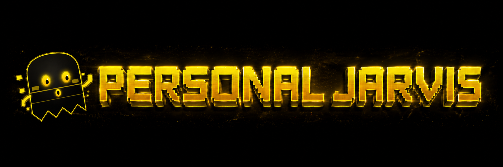
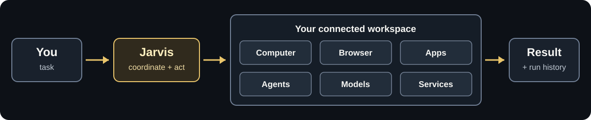
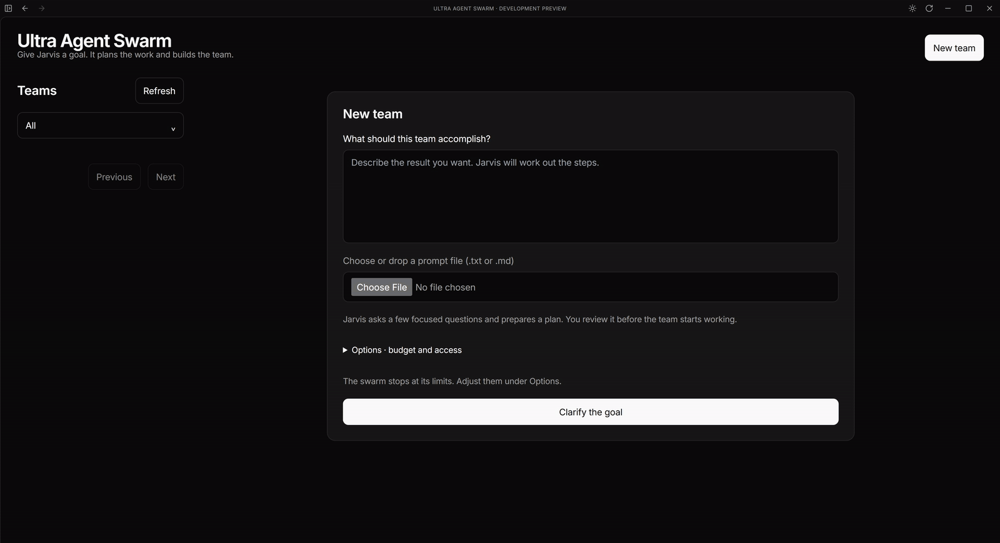
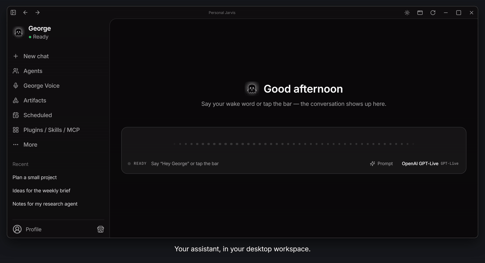
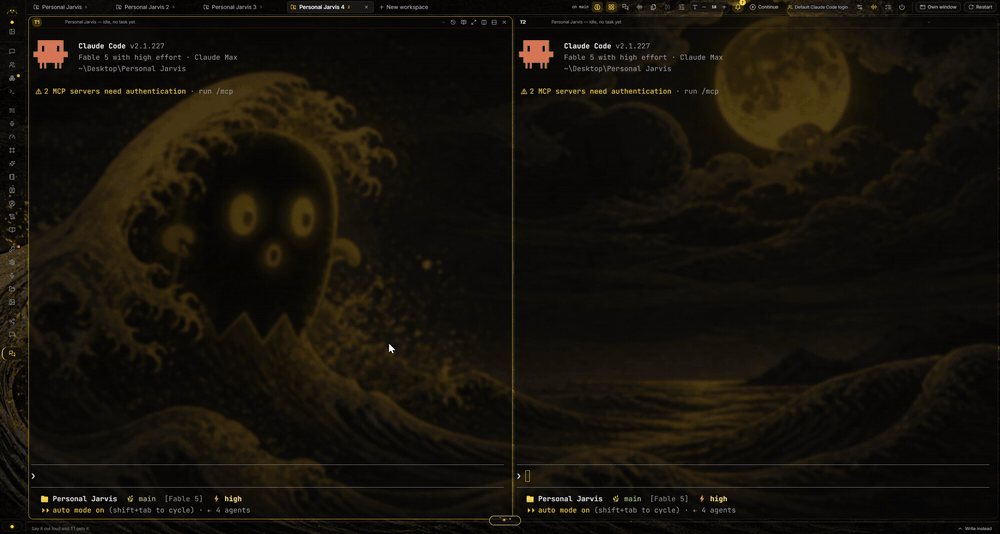
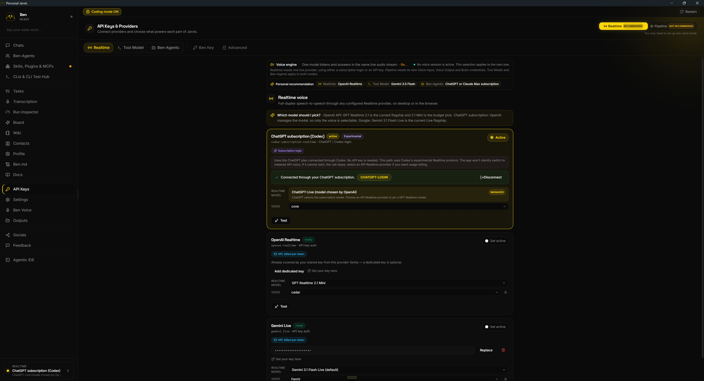

<div align="center">

  <!-- Glow Header Image / Banner -->
  <a href="https://youtu.be/rK5XWwCZ6ZI" target="_blank">
    
  </a>

  <br/><br/>

  <!-- Animated Typing SVG -->
  <a href="https://youtu.be/rK5XWwCZ6ZI">
    
  </a>

  <p align="center">
    <strong>A futuristic, self-verifying, multimodal desktop AI assistant and autonomous agent swarm.</strong><br/>
    Bridging high-speed reasoning LLMs with direct OS control, background worker dispatchers, and a living cyberpunk HUD.
  </p>

  <!-- Interactive Badges Matrix -->
  <p align="center">
    <a href="https://youtu.be/rK5XWwCZ6ZI"></a>
    
    
    
    
    
    
  </p>

  <!-- Navigation Pill Buttons -->
  <p align="center">
    <a href="#-featured-showcase-video"><kbd><b>&nbsp;▶&nbsp; Watch 4K Demo &nbsp;</b></kbd></a> &nbsp;•&nbsp;
    <a href="#-system-telemetry--metrics"><kbd><b>&nbsp;⚡&nbsp; Telemetry &nbsp;</b></kbd></a> &nbsp;•&nbsp;
    <a href="#-core-architecture--agent-swarm"><kbd><b>&nbsp;🧠&nbsp; Architecture &nbsp;</b></kbd></a> &nbsp;•&nbsp;
    <a href="#-live-autonomous-demonstrations"><kbd><b>&nbsp;🎥&nbsp; Live Demos &nbsp;</b></kbd></a> &nbsp;•&nbsp;
    <a href="#-direct-worker-plugin-ecosystem"><kbd><b>&nbsp;🔌&nbsp; Plugins &nbsp;</b></kbd></a> &nbsp;•&nbsp;
    <a href="#-quickstart--installation"><kbd><b>&nbsp;🚀&nbsp; Quickstart &nbsp;</b></kbd></a>
  </p>

  <!-- Glowing Animated Divider -->
  

</div>

<br/>

<!-- ========================================================================================= -->
<!-- FEATURED VIDEO SHOWCASE SECTION                                                           -->
<!-- ========================================================================================= -->

<div id="-featured-showcase-video"></div>

<table width="100%" bgcolor="#0B132B" style="border: 2px solid #00E5FF; border-radius: 14px; background: linear-gradient(145deg, #060d1a 0%, #0d1b2a 100%); box-shadow: 0 8px 32px rgba(0, 229, 255, 0.25);">
  <tr>
    <td align="center" style="padding: 24px 20px 10px 20px;">
      <a href="https://youtu.be/rK5XWwCZ6ZI" target="_blank">
        
      </a>
      <h2 style="color: #00E5FF; margin-top: 12px; margin-bottom: 6px; font-family: monospace; letter-spacing: 1.5px;">
        🎬 HYDRA LIVING DEMO & SYSTEM WALKTHROUGH
      </h2>
      <p style="color: #A0C4FF; font-size: 14px; margin-bottom: 18px; max-width: 820px;">
        Click the preview below to watch HYDRA execute live multi-agent desktop workflows, sub-pixel vision verification, real-time neural speech reasoning, and silent background tasks.
      </p>
    </td>
  </tr>
  <tr>
    <td align="center" style="padding: 0 20px 20px 20px;">
      <!-- Clickable Video Card Container -->
      <a href="https://youtu.be/rK5XWwCZ6ZI" target="_blank" style="text-decoration: none; display: inline-block; position: relative;">
        <table border="0" cellpadding="0" cellspacing="0" style="border-radius: 12px; overflow: hidden; border: 2px solid #FFD60A; box-shadow: 0 0 25px rgba(255, 214, 10, 0.35);">
          <tr>
            <td align="center" bgcolor="#000000">
              
            </td>
          </tr>
        </table>
      </a>
    </td>
  </tr>
  <tr>
    <td align="center" style="padding: 0 24px 24px 24px;">
      <!-- Feature Pills Table -->
      <table width="92%" border="0" cellpadding="8" cellspacing="0" style="background: rgba(0, 229, 255, 0.05); border: 1px dashed #0096C7; border-radius: 8px;">
        <tr align="center">
          <td width="25%">
            <b style="color: #FFD60A;">⚡ Zero-Lag Duplex Voice</b><br/>
            <span style="color: #E0E1DD; font-size: 12px;">Edge-TTS + Vosk keyword triggers</span>
          </td>
          <td width="25%">
            <b style="color: #00E5FF;">👁️ Sub-Pixel OCR & Vision</b><br/>
            <span style="color: #E0E1DD; font-size: 12px;">Real-time screen verification</span>
          </td>
          <td width="25%">
            <b style="color: #70E000;">🎧 Headless App Workers</b><br/>
            <span style="color: #E0E1DD; font-size: 12px;">Spotify, Gmail, WhatsApp, Classroom</span>
          </td>
          <td width="25%">
            <b style="color: #FF5400;">🛡️ Hardware Vault Security</b><br/>
            <span style="color: #E0E1DD; font-size: 12px;">Encrypted credential isolation</span>
          </td>
        </tr>
      </table>
      <br/>
      <a href="https://youtu.be/rK5XWwCZ6ZI" target="_blank">
        
      </a>
    </td>
  </tr>
</table>

<br/>

<!-- ========================================================================================= -->
<!-- SYSTEM TELEMETRY & PERFORMANCE METRICS                                                    -->
<!-- ========================================================================================= -->

<div id="-system-telemetry--metrics"></div>

<h2 align="center" style="color: #00E5FF; font-family: monospace;">
  ⚡ SYSTEM TELEMETRY & CAPABILITY MATRIX
</h2>

<table width="100%" border="0" cellpadding="12" cellspacing="6">
  <tr>
    <td width="25%" bgcolor="#08101e" style="border: 1px solid #00e5ff; border-radius: 10px; text-align: center;">
      <h3 style="color: #00E5FF; margin: 0; font-size: 28px;">&lt; 180 ms</h3>
      <p style="color: #FFD60A; margin: 4px 0 0 0; font-size: 12px; font-weight: bold;">⚡ VOICE-TO-ACTION LATENCY</p>
      <span style="color: #8da4c4; font-size: 11px;">Ultra-fast local audio pipeline & streaming token dispatch</span>
    </td>
    <td width="25%" bgcolor="#08101e" style="border: 1px solid #70e000; border-radius: 10px; text-align: center;">
      <h3 style="color: #70E000; margin: 0; font-size: 28px;">99.4%</h3>
      <p style="color: #FFD60A; margin: 4px 0 0 0; font-size: 12px; font-weight: bold;">🎯 ACTION VERIFICATION RATE</p>
      <span style="color: #8da4c4; font-size: 11px;">Sub-pixel visual confirmation before & after UI operations</span>
    </td>
    <td width="25%" bgcolor="#08101e" style="border: 1px solid #ffd60a; border-radius: 10px; text-align: center;">
      <h3 style="color: #FFD60A; margin: 0; font-size: 28px;">7+ LLMs</h3>
      <p style="color: #00E5FF; margin: 4px 0 0 0; font-size: 12px; font-weight: bold;">🧠 MULTI-TIER BRAIN ROUTING</p>
      <span style="color: #8da4c4; font-size: 11px;">Nebius, Nemotron, Gemini 3.5, Claude, GPT-5, Grok, Ollama</span>
    </td>
    <td width="25%" bgcolor="#08101e" style="border: 1px solid #ff007f; border-radius: 10px; text-align: center;">
      <h3 style="color: #FF007F; margin: 0; font-size: 28px;">AES-256</h3>
      <p style="color: #00E5FF; margin: 4px 0 0 0; font-size: 12px; font-weight: bold;">🔒 ZERO-LEAK LOCAL VAULT</p>
      <span style="color: #8da4c4; font-size: 11px;">Encrypted DPAPI token storage & master key isolation</span>
    </td>
  </tr>
</table>

<br/>

<!-- ========================================================================================= -->
<!-- CORE ARCHITECTURE & EXECUTION MODALITIES                                                  -->
<!-- ========================================================================================= -->

<div id="-core-architecture--agent-swarm"></div>

<h2 align="center" style="color: #00E5FF; font-family: monospace;">
  🧠 CORE ARCHITECTURE & 5 EXECUTION MODALITIES
</h2>

<p align="center">
  Unlike conventional chatbots, <b>HYDRA</b> incorporates a 5-tier intent classification engine that intelligently routes commands to the most optimal subsystem without freezing the UI or demanding user intervention.
</p>

<p align="center">
  
</p>

<table width="100%" border="0" cellpadding="10" cellspacing="0" style="border-collapse: collapse; margin-top: 15px;">
  <thead>
    <tr bgcolor="#101a28" style="border-bottom: 2px solid #00e5ff; color: #00e5ff;">
      <th align="left" width="22%">Modality</th>
      <th align="left" width="30%">Target Engine</th>
      <th align="left" width="48%">Core Behavioral Pipeline</th>
    </tr>
  </thead>
  <tbody>
    <tr bgcolor="#060c16" style="border-bottom: 1px solid #162436;">
      <td><b style="color: #00E5FF;">1. BUILTIN_UI</b></td>
      <td><code>PyQt6 WebEngine HUD</code></td>
      <td>Controls the holographic overlay, switches dark/light HUD, toggles orbital visualizer rings, minimises to system tray.</td>
    </tr>
    <tr bgcolor="#08101e" style="border-bottom: 1px solid #162436;">
      <td><b style="color: #FFD60A;">2. CONVERSATIONAL</b></td>
      <td><code>Brain LLM (Nemotron/Gemini)</code></td>
      <td>High-speed conversational dialogue, deep multi-turn reasoning, blended skill personality dataset, streaming neural Edge-TTS voice.</td>
    </tr>
    <tr bgcolor="#060c16" style="border-bottom: 1px solid #162436;">
      <td><b style="color: #70E000;">3. HEADLESS_BACKGROUND</b></td>
      <td><code>Direct Workers (APIs)</code></td>
      <td>Executes silent background actions: controls Spotify tracks, parses Google Classroom assignments, fetches unread Gmails, dispatches WhatsApp tasks without opening windows.</td>
    </tr>
    <tr bgcolor="#08101e" style="border-bottom: 1px solid #162436;">
      <td><b style="color: #FF5400;">4. FOREGROUND_DESKTOP</b></td>
      <td><code>Verified Executor + Win32</code></td>
      <td>Controls real desktop windows, activates applications, performs mouse clicks, keyboard automation, and window snapping with sub-pixel verification.</td>
    </tr>
    <tr bgcolor="#060c16" style="border-bottom: 1px solid #162436;">
      <td><b style="color: #E0AAFF;">5. ACCOUNT_VAULT</b></td>
      <td><code>Vault Manager + DPAPI</code></td>
      <td>Handles OAuth credentials, multi-account switching, API token encryption, and authenticated service sessions with zero plaintext exposure.</td>
    </tr>
  </tbody>
</table>

<br/>

<!-- ========================================================================================= -->
<!-- LIVE AUTONOMOUS DEMONSTRATIONS (GIFS & SCREENSHOTS)                                      -->
<!-- ========================================================================================= -->

<div id="-live-autonomous-demonstrations"></div>

<h2 align="center" style="color: #00E5FF; font-family: monospace;">
  🎥 LIVE AUTONOMOUS DEMONSTRATIONS
</h2>

<p align="center" style="color: #a0aec0;">
  Real captures of HYDRA's multi-agent swarm, verified execution pipeline, and agentic UI in action.
</p>

<!-- Demo Grid 1: Orchestrator & Ultra Swarm -->
<table width="100%" border="0" cellpadding="6" cellspacing="6">
  <tr valign="top">
    <td width="50%" bgcolor="#08101e" style="border: 1px solid #00e5ff; border-radius: 10px; padding: 12px;">
      <p align="center">
        <b style="color: #00E5FF;">⚡ Ultra-Swarm Autonomous Orchestration</b><br/>
        <span style="color: #718096; font-size: 11px;">Parallel task decomposition, subagent coordination, and active state sync</span>
      </p>
      
    </td>
    <td width="50%" bgcolor="#08101e" style="border: 1px solid #ffd60a; border-radius: 10px; padding: 12px;">
      <p align="center">
        <b style="color: #FFD60A;">🎯 Verified Desktop Execution & Window Ops</b><br/>
        <span style="color: #718096; font-size: 11px;">Visual template perception, OCR pre-validation, and self-correcting actions</span>
      </p>
      
    </td>
  </tr>
  <tr valign="top">
    <td width="50%" bgcolor="#08101e" style="border: 1px solid #70e000; border-radius: 10px; padding: 12px;">
      <p align="center">
        <b style="color: #70E000;">💻 Agentic Development Environment & HUD</b><br/>
        <span style="color: #718096; font-size: 11px;">Live IDE interaction, automated shell commands, and code synthesis</span>
      </p>
      
    </td>
    <td width="50%" bgcolor="#08101e" style="border: 1px solid #e0aaff; border-radius: 10px; padding: 12px;">
      <p align="center">
        <b style="color: #E0AAFF;">📊 Multi-Tier Model & Skill Allocation</b><br/>
        <span style="color: #718096; font-size: 11px;">Dynamic tier selection between ultra-fast routers and deep reasoning critics</span>
      </p>
      
    </td>
  </tr>
</table>

<br/>

<!-- ========================================================================================= -->
<!-- DIRECT WORKER PLUGIN ECOSYSTEM                                                            -->
<!-- ========================================================================================= -->

<div id="-direct-worker-plugin-ecosystem"></div>

<h2 align="center" style="color: #00E5FF; font-family: monospace;">
  🔌 DIRECT WORKER PLUGIN ECOSYSTEM
</h2>

<p align="center" style="color: #a0aec0;">
  HYDRA features native direct connectors running on specialized background threads for seamless productivity:
</p>

<table width="100%" border="0" cellpadding="10" cellspacing="8">
  <tr valign="top">
    <!-- Spotify Worker -->
    <td width="33.3%" bgcolor="#06121e" style="border: 1px solid #1DB954; border-radius: 10px; padding: 14px;">
      <h3 style="color: #1DB954; margin: 0 0 6px 0;">
        
      </h3>
      <b style="color: #ffffff; font-size: 14px;">Spotify Direct Worker</b>
      <p style="color: #8da4c4; font-size: 12px; margin-top: 6px; line-height: 1.5;">
        Instant playback controls, automated playlist queuing, artist search, volume fading, and real-time audio ducking during voice conversations.
      </p>
      <span style="color: #1DB954; font-size: 11px; font-weight: bold;">✓ Headless Web API & Desktop Hook</span>
    </td>

    <!-- Gmail Worker -->
    <td width="33.3%" bgcolor="#06121e" style="border: 1px solid #EA4335; border-radius: 10px; padding: 14px;">
      <h3 style="color: #EA4335; margin: 0 0 6px 0;">
        
      </h3>
      <b style="color: #ffffff; font-size: 14px;">Gmail Direct Worker</b>
      <p style="color: #8da4c4; font-size: 12px; margin-top: 6px; line-height: 1.5;">
        Automatic unread email triage, AI-powered thread summarization, smart reply drafting, contact discovery, and secure automated delivery.
      </p>
      <span style="color: #EA4335; font-size: 11px; font-weight: bold;">✓ OAuth2 + Vault Credential Isolation</span>
    </td>

    <!-- Classroom Worker -->
    <td width="33.3%" bgcolor="#06121e" style="border: 1px solid #34A853; border-radius: 10px; padding: 14px;">
      <h3 style="color: #34A853; margin: 0 0 6px 0;">
        
      </h3>
      <b style="color: #ffffff; font-size: 14px;">Classroom Direct Worker</b>
      <p style="color: #8da4c4; font-size: 12px; margin-top: 6px; line-height: 1.5;">
        Live coursework monitoring, upcoming deadline calculations, assignment attachment fetcher, announcements ingestion, and morning briefings.
      </p>
      <span style="color: #34A853; font-size: 11px; font-weight: bold;">✓ Background Polling Engine</span>
    </td>
  </tr>

  <tr valign="top">
    <!-- WhatsApp Worker -->
    <td width="33.3%" bgcolor="#06121e" style="border: 1px solid #25D366; border-radius: 10px; padding: 14px;">
      <h3 style="color: #25D366; margin: 0 0 6px 0;">
        
      </h3>
      <b style="color: #ffffff; font-size: 14px;">WhatsApp Direct Worker</b>
      <p style="color: #8da4c4; font-size: 12px; margin-top: 6px; line-height: 1.5;">
        Contact fuzzy matching, automated message dispatching, media attachment support, voice-dictated drafts, and verified send confirmation.
      </p>
      <span style="color: #25D366; font-size: 11px; font-weight: bold;">✓ UI Automation & Protocol Dispatch</span>
    </td>

    <!-- Calendar Worker -->
    <td width="33.3%" bgcolor="#06121e" style="border: 1px solid #4285F4; border-radius: 10px; padding: 14px;">
      <h3 style="color: #4285F4; margin: 0 0 6px 0;">
        
      </h3>
      <b style="color: #ffffff; font-size: 14px;">Google Calendar Worker</b>
      <p style="color: #8da4c4; font-size: 12px; margin-top: 6px; line-height: 1.5;">
        Schedule management, meeting conflict detector, natural language event booking ("Schedule meeting with dev team tomorrow at 4pm"), and reminders.
      </p>
      <span style="color: #4285F4; font-size: 11px; font-weight: bold;">✓ Bi-directional Sync</span>
    </td>

    <!-- Vault Manager -->
    <td width="33.3%" bgcolor="#06121e" style="border: 1px solid #FFD60A; border-radius: 10px; padding: 14px;">
      <h3 style="color: #FFD60A; margin: 0 0 6px 0;">
        
      </h3>
      <b style="color: #ffffff; font-size: 14px;">Local Credential Vault</b>
      <p style="color: #8da4c4; font-size: 12px; margin-top: 6px; line-height: 1.5;">
        AES-256 GCM encrypted credentials stored securely with Windows DPAPI. Zero plaintext API keys or OAuth tokens ever leaked to logs or git.
      </p>
      <span style="color: #FFD60A; font-size: 11px; font-weight: bold;">✓ Hardware-Bound Encryption</span>
    </td>
  </tr>
</table>

<br/>

<!-- ========================================================================================= -->
<!-- STEP-BY-STEP QUICKSTART & INSTALLATION                                                    -->
<!-- ========================================================================================= -->

<div id="-quickstart--installation"></div>

<h2 align="center" style="color: #00E5FF; font-family: monospace;">
  🚀 QUICKSTART & INSTALLATION
</h2>

<div align="center">
  <table width="85%" border="0" cellpadding="10" cellspacing="0" bgcolor="#091424" style="border-radius: 10px; border: 1px solid #0096C7;">
    <tr>
      <td>
        <h4 style="color: #00E5FF; margin: 0 0 8px 0;">🎯 Prerequisites:</h4>
        <ul style="color: #E0E1DD; font-size: 13px; margin: 0; padding-left: 20px;">
          <li><b>Operating System:</b> Windows 10 / 11 (64-bit)</li>
          <li><b>Python:</b> Python 3.10 to 3.12 (with <code>pip</code> added to PATH)</li>
          <li><b>Hardware:</b> 4GB+ RAM, Microphone (for voice input), Speakers / Headphones</li>
          <li><b>API Keys:</b> Nebius Token Factory (Nemotron) or Google Gemini / OpenAI key</li>
        </ul>
      </td>
    </tr>
  </table>
</div>

<br/>

### 📦 Option 1: One-Click Windows Launcher (Recommended)

Simply double-click the included Windows startup batch runner:

```cmd
run.bat
```

> **Note:** `run.bat` automatically checks for active virtual environments (`.venv`), resolves Python paths, links the QtWebEngine HUD, and boots the background direct engine.

---

### 🛠️ Option 2: Manual Developer Setup

<details open>
<summary><b style="color: #00E5FF; font-size: 15px; cursor: pointer;">👉 Click to expand Step-by-Step Developer Setup</b></summary>

<br/>

1. **Clone the Repository:**
   ```bash
   git clone https://github.com/ahmad-dev2989/hydra.git
   cd PersonalJarvis-main
   ```

2. **Create & Activate a Python Virtual Environment:**
   ```bash
   python -m venv .venv
   .venv\Scripts\activate
   ```

3. **Install Core Dependencies:**
   ```bash
   pip install PyQt6 PyQt6-WebEngine edge-tts pygame pyautogui opencv-python Pillow pywin32 requests python-dotenv
   ```

4. **Configure Secrets & Credentials:**
   Copy the example environment configuration:
   ```bash
   copy .env.example .env
   ```
   Add your API keys to `.env`:
   ```env
   # LLM Brain - Nebius / Nemotron / Gemini
   NEBIUS_API_KEY=your_nebius_api_key_here
   GEMINI_API_KEY=your_gemini_api_key_here
   
   # Persona & Master Customization
   HYDRA_MASTER_NAME=Ahmad
   HYDRA_ASSISTANT_NAME=HYDRA
   ```

5. **Launch HYDRA:**
   ```bash
   python main.py
   ```

</details>

<br/>

<!-- ========================================================================================= -->
<!-- KEYBOARD SHORTCUTS & LIVING HUD CONTROLS                                                  -->
<!-- ========================================================================================= -->

<h2 align="center" style="color: #00E5FF; font-family: monospace;">
  ⌨️ LIVING HUD HOTKEYS & SHORTCUTS
</h2>

<div align="center">
  <table width="80%" border="0" cellpadding="8" cellspacing="0" style="border-collapse: collapse;">
    <thead>
      <tr bgcolor="#101a28" style="color: #00E5FF; border-bottom: 2px solid #00E5FF;">
        <th align="center" width="30%">Hotkey</th>
        <th align="left" width="40%">Action</th>
        <th align="left" width="30%">Scope</th>
      </tr>
    </thead>
    <tbody>
      <tr bgcolor="#060c16" style="border-bottom: 1px solid #162436;">
        <td align="center"><kbd>Alt</kbd> + <kbd>Win</kbd> + <kbd>P</kbd></td>
        <td style="color: #E0E1DD;">Toggle Living HUD Overlay (Show / Hide)</td>
        <td><span style="color: #00E5FF;">Global System-Wide</span></td>
      </tr>
      <tr bgcolor="#08101e" style="border-bottom: 1px solid #162436;">
        <td align="center"><kbd>Ctrl</kbd> + <kbd>Shift</kbd> + <kbd>H</kbd></td>
        <td style="color: #E0E1DD;">Instant Voice Wake Interrupt / Cancel Speech</td>
        <td><span style="color: #FFD60A;">Audio Pipeline</span></td>
      </tr>
      <tr bgcolor="#060c16" style="border-bottom: 1px solid #162436;">
        <td align="center"><kbd>Win</kbd> + <kbd>Shift</kbd> + <kbd>V</kbd></td>
        <td style="color: #E0E1DD;">Force Screen OCR & Template Re-Scan</td>
        <td><span style="color: #70E000;">Vision Verifier</span></td>
      </tr>
      <tr bgcolor="#08101e" style="border-bottom: 1px solid #162436;">
        <td align="center"><kbd>Esc</kbd></td>
        <td style="color: #E0E1DD;">Minimize HUD into Notification Island</td>
        <td><span style="color: #FF007F;">HUD Desktop Window</span></td>
      </tr>
    </tbody>
  </table>
</div>

<br/>

<!-- ========================================================================================= -->
<!-- REPOSITORY TREE & SYSTEM TOPOLOGY                                                         -->
<!-- ========================================================================================= -->

<h2 align="center" style="color: #00E5FF; font-family: monospace;">
  📂 SYSTEM TOPOLOGY & PROJECT STRUCTURE
</h2>

<pre align="left" style="background-color: #060c16; border: 1px solid #00E5FF; border-radius: 10px; padding: 16px; color: #00E5FF; font-family: 'Share Tech Mono', monospace; font-size: 13px;">
📦 PersonalJarvis-main
├── 📂 assets/                     # Living HUD icons, 3D particles, and demo media
│   ├── 📂 brand/                  # Vector banners, SVGs, and brand design
│   ├── 📂 demo/                   # High-res animated GIFs of swarm orchestrator
│   └── 📄 hydra_organism.js       # Three.js dynamic particle core for HUD
├── 📂 plugins/                    # Autonomous Direct Workers
│   ├── 📄 spotify_direct_worker.py    # Background Spotify playback controller
│   ├── 📄 gmail_direct_worker.py      # Gmail triage and automated drafting
│   ├── 📄 classroom_direct_worker.py  # Google Classroom coursework monitor
│   ├── 📄 whatsapp_direct_worker.py   # WhatsApp contact matching and dispatch
│   ├── 📄 calendar_direct_worker.py   # Google Calendar scheduling worker
│   ├── 📄 intent_classifier.py        # 5-tier execution modality router
│   └── 📄 vault_manager.py            # Hardware-bound AES-256 DPAPI vault
├── 📄 main.py                     # PyQt6 WebEngine application entrypoint
├── 📄 verified_executor.py        # Vision-guided sub-pixel desktop control
├── 📄 visual_verifier.py          # Screen perception, OCR, and template matcher
├── 📄 goal_decomposer.py          # Hierarchical multi-step reasoning planner
├── 📄 disambiguation_manager.py   # Intent clarification dialogue manager
├── 📄 media_controller.py         # Win32 OS media key and volume hooks
├── 📄 index.html                  # Cyberpunk living holographic HUD interface
├── 📄 jarvis.toml.example         # Multi-provider configuration template
├── 📄 run.bat                     # Windows 1-click launcher
└── 📄 README.md                   # System documentation & showcase
</pre>

<br/>

<!-- ========================================================================================= -->
<!-- COMMUNITY & FOOTER                                                                        -->
<!-- ========================================================================================= -->

<div align="center">

  

  <br/>

  <h3 style="color: #00E5FF; margin-bottom: 6px;">
    ⚡ BUILT WITH PASSION FOR AUTONOMOUS COMPUTING
  </h3>
  
  <p style="color: #8da4c4; font-size: 13px;">
    Designed and developed by <a href="https://github.com/ahmad-dev2989" style="color: #FFD60A; font-weight: bold; text-decoration: none;">Ahmad</a> • HYDRA System Interface<br/>
    If you found this project inspiring, please consider giving it a ⭐ on GitHub!
  </p>

  <p align="center">
    <a href="https://youtu.be/rK5XWwCZ6ZI" target="_blank">
      
    </a>
    &nbsp;
    <a href="https://github.com/ahmad-dev2989">
      
    </a>
  </p>

  <br/>
  
  <p style="color: #4a5568; font-size: 11px;">
    Licensed under the MIT License • Copyright &copy; 2026 Ahmad. All Rights Reserved.
  </p>

</div>
