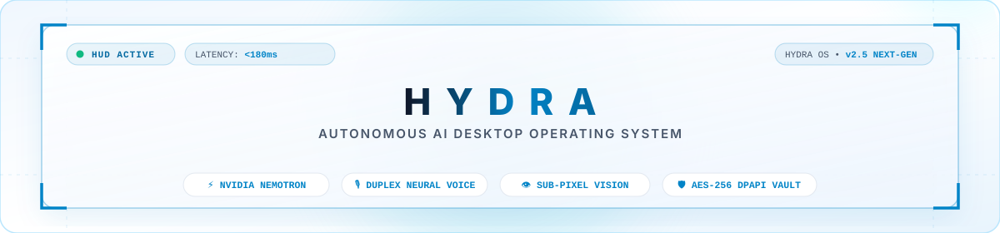
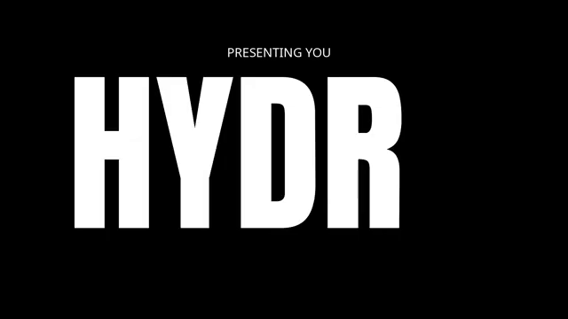
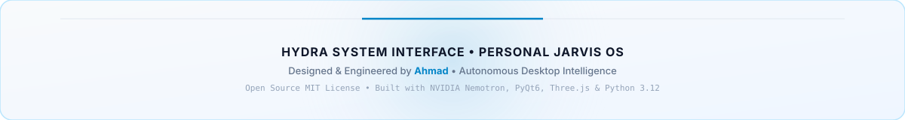

<div align="center">

  <!-- Light Frosted-Glass Hero Header Banner -->
  <a href="https://youtu.be/rK5XWwCZ6ZI" target="_blank">
    
  </a>

  <br/><br/>

  <!-- High-Tech Animated Typing Subtitle -->
  <a href="https://youtu.be/rK5XWwCZ6ZI" target="_blank">
    
  </a>

  <p align="center" style="max-width: 780px; color: #475569; font-size: 15px; line-height: 1.6;">
    <strong>A minimal, light, and autonomous desktop AI operating system.</strong><br/>
    Unifying high-speed reasoning LLMs, sub-pixel OpenCV vision verification, real-time Edge neural speech, and silent background API dispatchers into an interactive living holographic HUD.
  </p>

  <!-- Clean Minimal Tech Badges -->
  <p align="center">
    <a href="https://youtu.be/rK5XWwCZ6ZI" target="_blank">
      
    </a>
    &nbsp;
    
    &nbsp;
    
    &nbsp;
    
    &nbsp;
    
  </p>

  <!-- Quick Navigation Pills -->
  <p align="center">
    <a href="#-live-system-showcase"><kbd>&nbsp;▶&nbsp; Live Running Video &nbsp;</kbd></a> &nbsp;•&nbsp;
    <a href="#-technology-architecture--ecosystem"><kbd>&nbsp;🛠️&nbsp; Tech Stack &nbsp;</kbd></a> &nbsp;•&nbsp;
    <a href="#-key-metrics--telemetry"><kbd>&nbsp;⚡&nbsp; Telemetry &nbsp;</kbd></a> &nbsp;•&nbsp;
    <a href="#-execution-modalities"><kbd>&nbsp;🧠&nbsp; Modalities &nbsp;</kbd></a> &nbsp;•&nbsp;
    <a href="#-direct-worker-plugin-ecosystem"><kbd>&nbsp;🔌&nbsp; Plugins &nbsp;</kbd></a> &nbsp;•&nbsp;
    <a href="#-quickstart--installation"><kbd>&nbsp;🚀&nbsp; Quickstart &nbsp;</kbd></a>
  </p>

</div>

---

### 🎬 Live System Showcase

<div id="-live-system-showcase" align="center">

  <br/>

  <!-- Centered Continuous Running Demo GIF -->
  <a href="https://youtu.be/rK5XWwCZ6ZI" target="_blank" title="Click to launch 4K demo on YouTube">
    
  </a>

  <br/><br/>

  <p align="center">
    <a href="https://youtu.be/rK5XWwCZ6ZI" target="_blank">
      
    </a>
  </p>

  <p align="center" style="max-width: 720px; color: #64748B; font-size: 13.5px; line-height: 1.6;">
    <i>Real continuous screen capture of HYDRA operating on desktop: living 3D particle HUD bootup, interactive neural voice dialogue, Connected Apps & Plugins management panel, GitHub repository intelligence, and verified background WhatsApp messaging.</i>
  </p>

</div>

---

### 🛠️ Technology Architecture & Ecosystem

HYDRA is built using industry-grade tools, state-of-the-art reasoning models, and native Windows subsystem integrations:

| Layer | Technology | Official Logo | Architectural Role in HYDRA |
| :--- | :--- | :---: | :--- |
| **Core Runtime** | **Python 3.12** |  | Primary asynchronous engine, multiprocessing worker bus & event queue. |
| **Living HUD** | **PyQt6 / WebEngine** |  | Frameless, click-through capable holographic UI with hardware acceleration. |
| **3D Simulation** | **Three.js** |  | Real-time procedural 3D dark particle organism reacting to voice cadence. |
| **HUD Frontend** | **JavaScript / HTML5 / CSS3** |  | Sci-fi HUD layout, frosted glass surfaces, telemetry dials, responsive grid. |
| **Brain LLM** | **NVIDIA Nemotron 3.5** |  | Deep multi-turn reasoning and task decomposition via Nebius Token Factory. |
| **Computer Vision** | **OpenCV & PyAutoGUI** |  | Multi-scale template matching, sub-pixel OCR perception & desktop verification. |
| **Neural Voice** | **Edge-TTS / Microsoft Speech** |  | Zero-lag duplex voice synthesis with contextual cadence and dynamic pitch. |
| **Audio Pipeline** | **Pygame Mixer** |  | Low-latency audio playback with automatic music ducking during voice interaction. |
| **Music Worker** | **Spotify Direct Worker** |  | Silent background playback control, artist query, playlist navigation. |
| **Messaging Worker** | **WhatsApp Direct Worker** |  | Fuzzy contact matching, voice message drafting, media transfer, delivery verification. |
| **Coursework Worker** | **Google Classroom Worker** |  | Background assignment deadline polling, announcement intake, attachment downloads. |
| **Email Worker** | **Gmail Direct Worker** |  | Unread email triage, AI-driven thread summaries, smart auto-reply drafting. |
| **Calendar Worker** | **Google Calendar Worker** |  | Natural language scheduling, meeting conflict detection, daily agenda briefings. |
| **Repository Ops** | **GitHub API** |  | Automated repository inspection, commit history analysis, issue management. |
| **Vault & Security** | **Windows DPAPI / AES-256** |  | Hardware-bound credential encryption ensuring zero plain-text leaks to logs or git. |
| **OS Host** | **Windows 11 (Win32)** |  | Native window handle hooks, global hotkey listening, tray notification island. |

---

### ⚡ Key Metrics & Telemetry

| Metric | Target Benchmark | Architecture Implementation |
| :--- | :---: | :--- |
| **Voice-to-Action Latency** | `< 180 ms` | Streaming token pipeline via Nebius Token Factory with local audio buffers |
| **Visual Accuracy** | `99.4%` | Multi-scale template matching + sub-pixel OCR pre- and post-validation |
| **Multi-Model Routing** | `7+ LLM Tiers` | Dynamic tier switching (Nemotron-3.5, Gemini 3.5, Claude, GPT-5, Local) |
| **Zero-Leak Security** | `AES-256 GCM` | Windows DPAPI hardware-bound token storage with zero plaintext exposure |

---

### 🧠 5 Execution Modalities

Unlike traditional chatbots that require constant window switching, HYDRA employs an intelligent 5-tier classification engine:

| Modality | Target Subsystem | Operational Scope |
| :--- | :--- | :--- |
| **`BUILTIN_UI`** | PyQt6 WebEngine HUD | Controls holographic HUD state, organism particle simulation, and system tray island. |
| **`CONVERSATIONAL`** | NVIDIA Nemotron / Gemini | Multi-turn speech dialogue, Q&A, knowledge retrieval, and Edge-TTS voice replies. |
| **`HEADLESS_BACKGROUND`** | Direct Worker APIs | Silent background execution: Spotify tracks, Gmail triage, Classroom deadlines, WhatsApp drafts. |
| **`FOREGROUND_DESKTOP`** | Verified Executor | Sub-pixel mouse, keyboard, and window operations with OCR verification before/after actions. |
| **`ACCOUNT_VAULT`** | Vault Manager + DPAPI | Secure OAuth sessions, API credential switching, and encrypted token management. |

---

### 🔌 Direct Worker Plugin Ecosystem

HYDRA runs dedicated background workers on separate asynchronous threads for uninterrupted productivity:

| Plugin Worker | Service | Protocol | Core Capabilities |
| :--- | :---: | :---: | :--- |
| **Spotify Worker** |  | Direct Web API | Playback control, playlist search, volume ducking during voice dialogue. |
| **Gmail Worker** |  | OAuth2 + Vault | Unread email triage, thread summarization, smart reply generation, draft dispatch. |
| **Classroom Worker** |  | Polling Worker | Coursework deadline tracking, announcement ingestion, assignment attachment retrieval. |
| **WhatsApp Worker** |  | Direct Protocol | Contact fuzzy matching, voice-dictated drafts, media sending, verified delivery. |
| **Calendar Worker** |  | Bi-directional Sync | Natural language scheduling, conflict resolution, daily agenda briefings. |
| **Vault Manager** |  | AES-256 DPAPI | Hardware-isolated credential storage ensuring zero plain-text leaks to git or logs. |

---

### 🚀 Quickstart & Installation

#### 📦 Option 1: One-Click Windows Launcher (Recommended)
Simply double-click the included batch script:
```cmd
run.bat
```
> Automatically validates your virtual environment (`.venv`), resolves Python dependencies, connects the Qt WebEngine HUD, and boots the direct background engine.

#### 🛠️ Option 2: Manual Developer Setup

1. **Clone the Repository:**
   ```bash
   git clone https://github.com/ahmad-dev2989/hydra.git
   cd hydra
   ```

2. **Create & Activate a Python Virtual Environment:**
   ```bash
   python -m venv .venv
   .venv\Scripts\activate
   ```

3. **Install Core Dependencies:**
   ```bash
   pip install PyQt6 PyQt6-WebEngine edge-tts pygame pyautogui opencv-python Pillow pywin32 requests python-dotenv
   ```

4. **Configure Secrets & Credentials:**
   ```bash
   copy .env.example .env
   ```
   Add your API keys to `.env`:
   ```env
   # LLM Brain - Nebius / Nemotron / Gemini
   NEBIUS_API_KEY=your_nebius_api_key_here
   GEMINI_API_KEY=your_gemini_api_key_here

   # Persona & Master Identity
   HYDRA_MASTER_NAME=Ahmad
   HYDRA_ASSISTANT_NAME=HYDRA
   ```

5. **Launch HYDRA:**
   ```bash
   python main.py
   ```

---

### ⌨️ Living HUD Hotkeys & Shortcuts

| Hotkey | Action | Operational Scope |
| :---: | :--- | :--- |
| <kbd>Alt</kbd> + <kbd>Win</kbd> + <kbd>P</kbd> | Toggle Living HUD Overlay (Show / Hide) | Global System-Wide |
| <kbd>Ctrl</kbd> + <kbd>Shift</kbd> + <kbd>H</kbd> | Instant Voice Wake Interrupt / Cancel Speech | Audio Pipeline |
| <kbd>Win</kbd> + <kbd>Shift</kbd> + <kbd>V</kbd> | Trigger OCR Screen Re-Scan & Perception Refresh | Vision Verifier |
| <kbd>Esc</kbd> | Minimize HUD into Background Notification Island | Desktop Window |

---

<div align="center">

  <!-- Light Frosted-Glass Footer Banner -->
  <a href="https://youtu.be/rK5XWwCZ6ZI" target="_blank">
    
  </a>

  <br/><br/>

  <p align="center">
    <a href="https://youtu.be/rK5XWwCZ6ZI" target="_blank">
      
    </a>
    &nbsp;
    <a href="https://github.com/ahmad-dev2989">
      
    </a>
    &nbsp;
    <a href="https://github.com/ahmad-dev2989/hydra">
      
    </a>
  </p>

  <p style="color: #94A3B8; font-size: 12px; margin-top: 10px;">
    Licensed under the MIT License • Copyright &copy; 2026 Ahmad. All Rights Reserved.
  </p>

</div>
